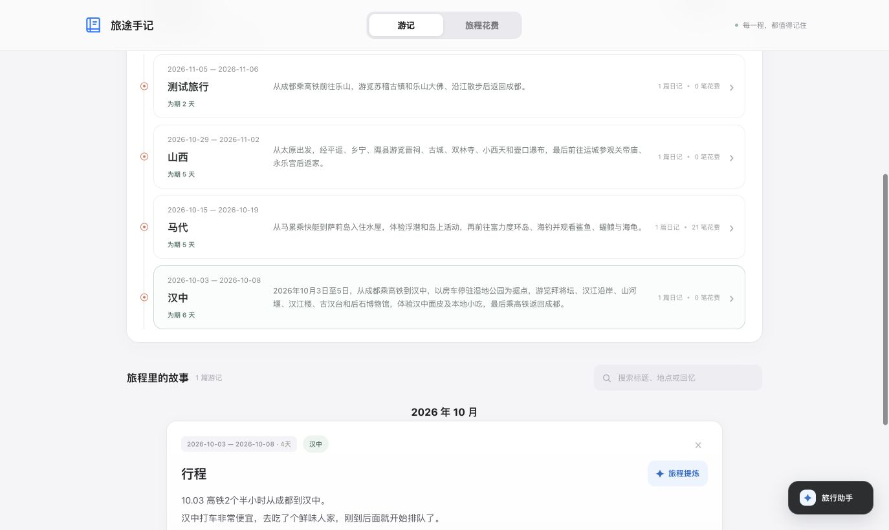
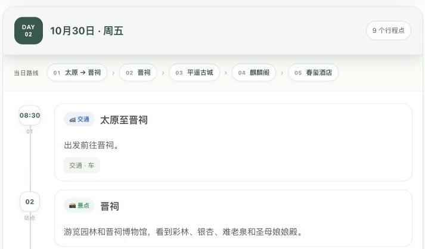
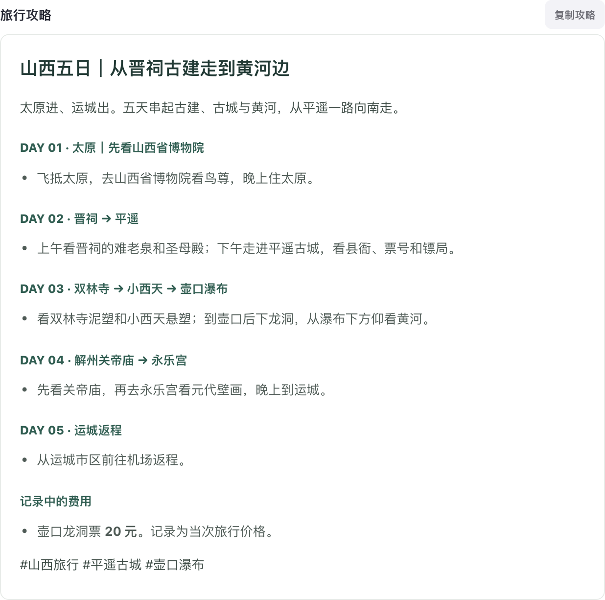
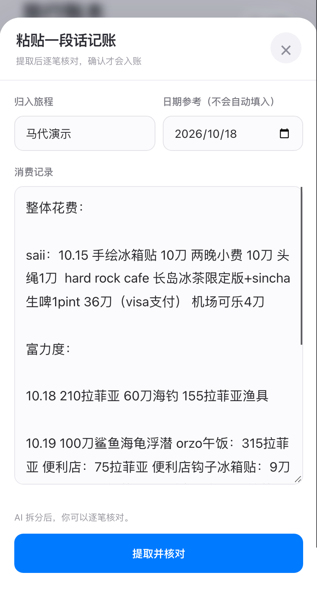
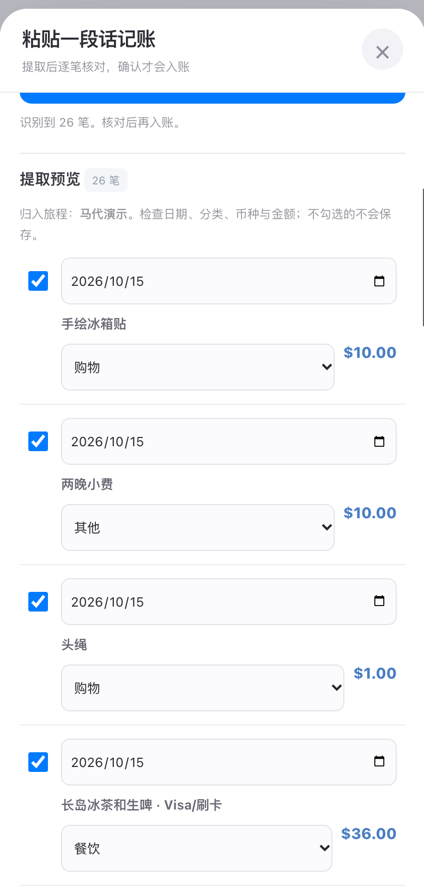
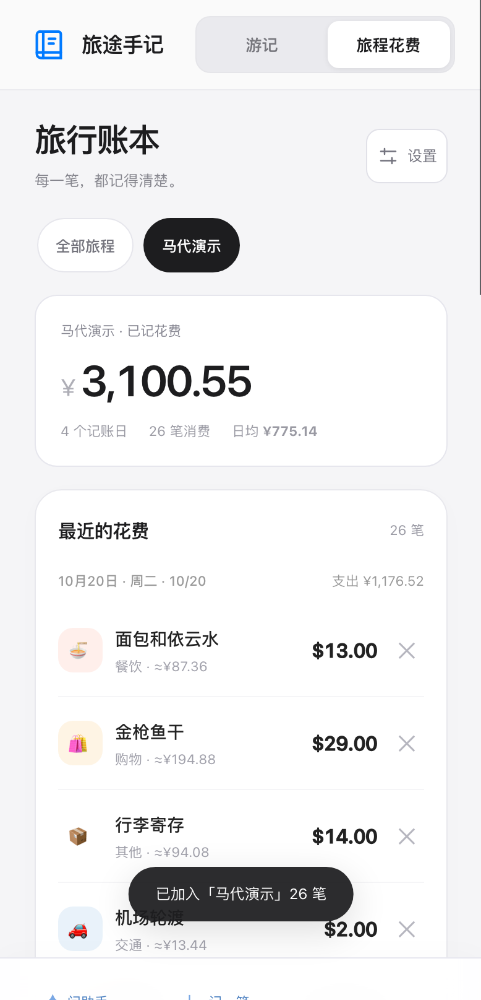
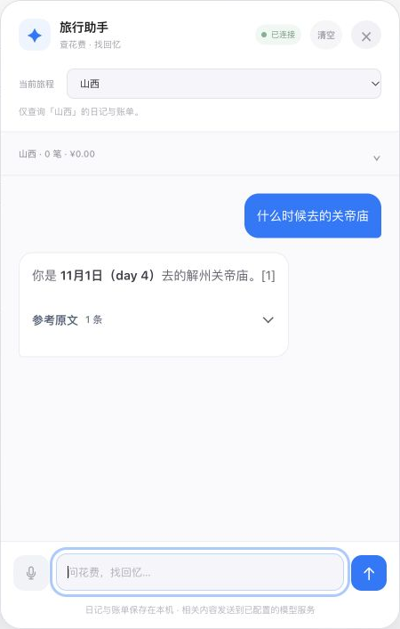
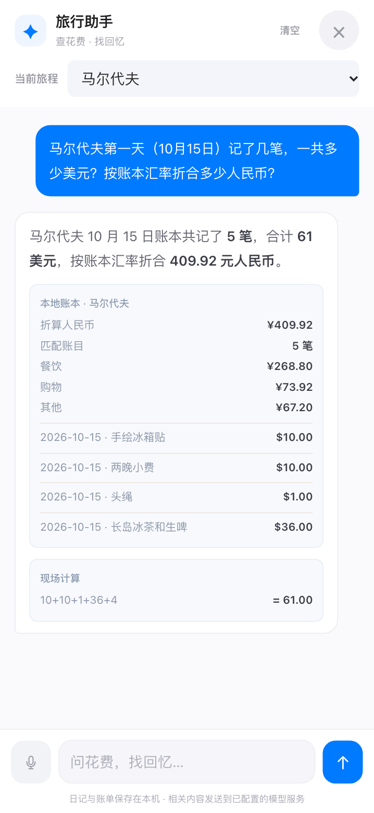
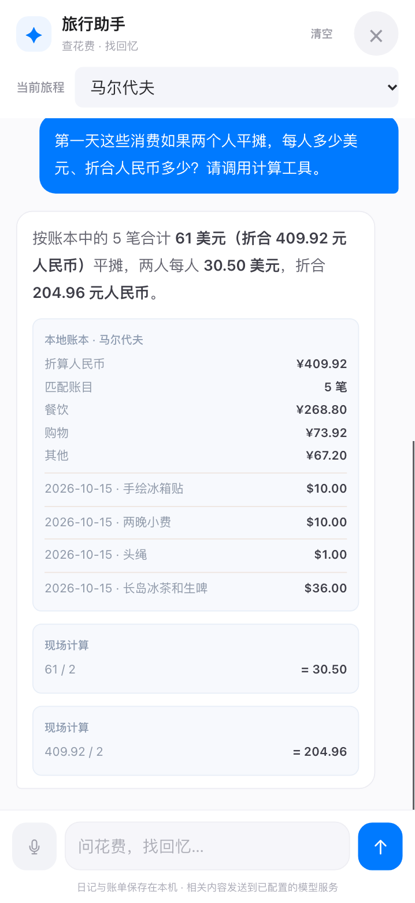

# 旅途手记

记录游记、整理每日行程、管理旅行花费，并通过旅行助手查询日记与账单。支持电脑和手机使用。

## 旅程时间线

按年份或全部旅程浏览旅行记录。每段旅程展示起止日期、天数、一句话总结、日记篇数和消费笔数；点击进入对应游记与账本，支持按旅程筛选和搜索。



## 游记记录与提炼

- 支持文字输入、粘贴长文和语音录入，可设置旅程日期范围，搜索、拆分、合并和导出游记。
- 保存后自动提炼主题、摘要、日期与每日行程，按天展示地点、路线和活动。
- 根据游记生成旅行攻略，可复制分享；消费建议经核对后可记入账本。
- 提炼结果保存后可再次查看，也可手动重新提炼。

<table>
  <tr><th>每日行程</th><th>旅行攻略</th></tr>
  <tr>
    <td width="50%"></td>
    <td width="50%"></td>
  </tr>
</table>

## 旅行账本

支持手动记一笔、粘贴整段消费和对话记账。批量录入时按日期与币种拆分明细，可逐笔修改、勾选，确认后统一入账。

账本保留原币金额，并按设置的汇率折算人民币；支持分类、支付方式、每日趋势、总预算和导出。删除账单支持撤销与恢复，旅程卡片同步更新消费笔数。

<table>
  <tr><th>粘贴消费</th><th>逐笔核对</th><th>账本明细</th></tr>
  <tr>
    <td></td>
    <td></td>
    <td></td>
  </tr>
</table>

## 旅行助手

选择具体旅程或全部旅程后，可通过文字、语音提问并连续追问。

| 功能 | 示例 |
| --- | --- |
| 查找日记 | “海钓后吃午饭的店叫什么？”附可打开的原文引用。 |
| 查询账单 | “机场行李寄存多少钱？”返回匹配账单的金额与日期。 |
| 汇总花费 | “每天分别花了多少？”支持按日期、分类、币种和支付方式统计。 |
| 现场计算 | “扣除住宿后三个人平摊，每人多少？”展示计算结果与算式。 |
| 记账与删除 | 对话录入消费；批量消费和删除操作先展示核对卡。 |

<table>
  <tr><th>日记问答</th><th>账单查询</th><th>费用平摊</th></tr>
  <tr>
    <td></td>
    <td></td>
    <td></td>
  </tr>
</table>

## 部署

需要 **Node.js 20+** 和一个支持 **Responses API、工具调用（Function Calling）及 JSON 输出**的模型服务。

下载代码后，将根目录的 `.env.example` 复制为 `.env`，填写模型地址、模型 ID 与 API Key：

```dotenv
MODEL_PROVIDER=openai-compatible
OPENAI_BASE_URL=https://your-model-service.example/v1
OPENAI_MODEL=your-function-calling-model-id
OPENAI_API_KEY=your-own-key
```

运行 `npm start` 启动服务。**默认端口为 4173，可在 `.env` 或部署平台的环境变量中通过 `PORT` 修改**，访问地址以启动输出为准。修改配置后需重启服务。

日记、账单与提炼结果保存在当前浏览器，支持导出。使用 AI 功能时，相关记录会发送至所配置的模型服务。API Key 仅在服务端配置，`.env` 不提交到仓库。
